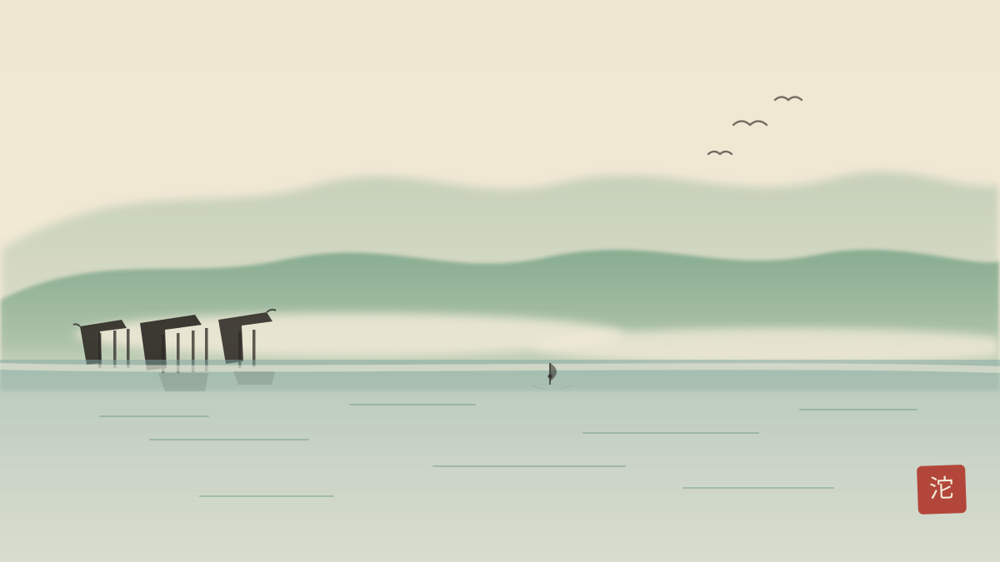

沱江边的吊脚楼是凤凰的名片。大多数导游讲「少数民族特色」就带过去了，但这批楼真正值得讲的是一件工程学的事：**它们是怎么把房子立在水边软土上的。**

<!--more-->

## 为什么值得讲

凤凰的吊脚楼多为明清遗构，穿斗式木结构，临江一面悬挑出长长的木柱。核心智慧有三条：

1. **柱落脚在江岸岩层上**，而不是河滩软泥——选址本身就是地质判断。
2. **穿斗式构架用小材干大事**：不需要一根大梁，细木柱穿枋拉结成整体，抗震且省料。
3. **木柱底部垫石墩**，石木之间不直接入土，隔水防潮防腐，这是它们能站两百年的关键。

## 讲解词参考

> 大家看这排房子的「脚」——长长的木柱从楼底一直插到江岸下面。看着悬，其实稳：柱子落脚的地方是江岸的岩层，不是淤泥。木柱底下都垫了石墩，木头不直接接触水土，所以两百年不烂。这是当年湘西人用最省的材料、在最难的地块上盖的房子——智慧的民居，从来不是越盖越大，而是越盖越巧。

## 冷知识

- 「吊脚」挑出的部分叫「挑」，临江房间多作卧室，旧时有个浪漫的说法叫「枕水而眠」。
- 凤凰吊脚楼群最密集的回龙阁一段，全长约 200 米，是拍照的黄金机位，清晨六点半前后江面起雾时最好。
- 2001 年凤凰古城作为整体被列为国家历史文化名城，吊脚楼群是核心保护对象。
