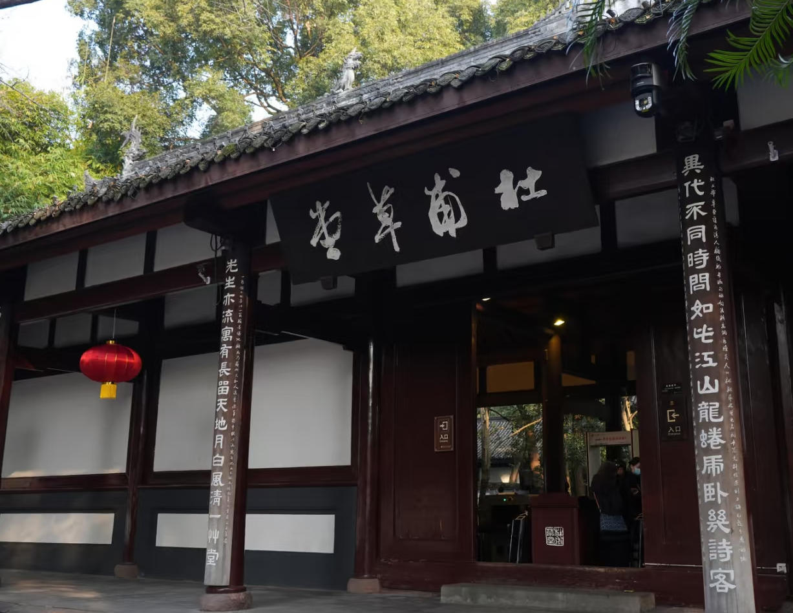
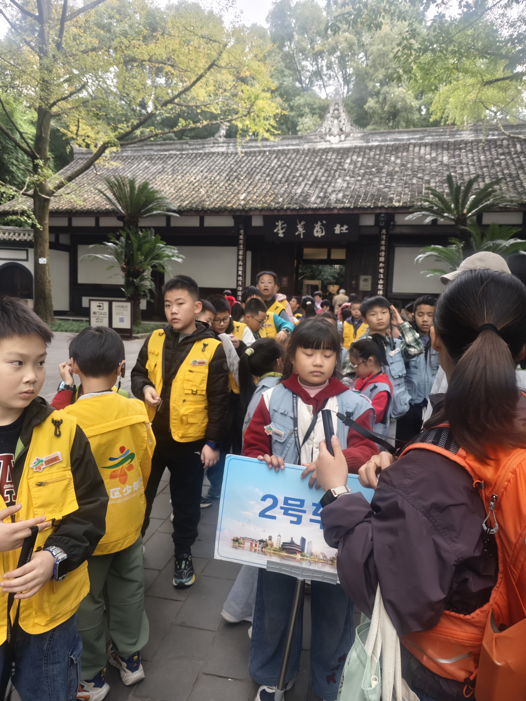
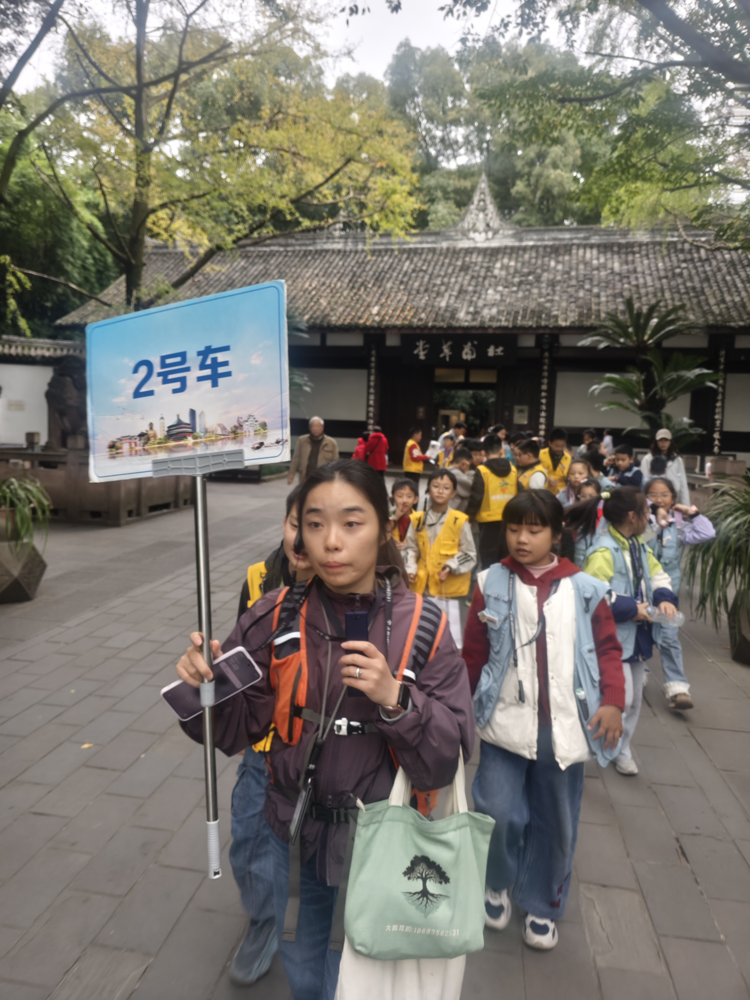
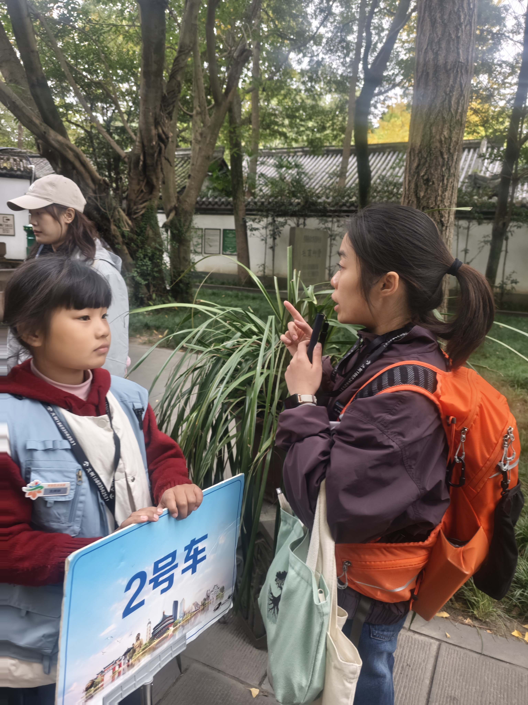
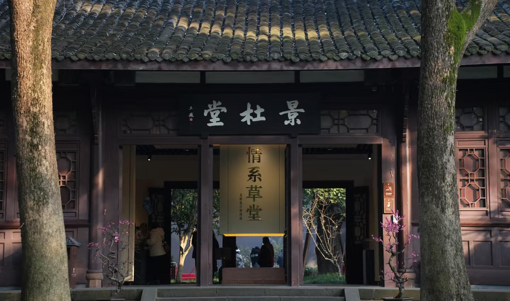
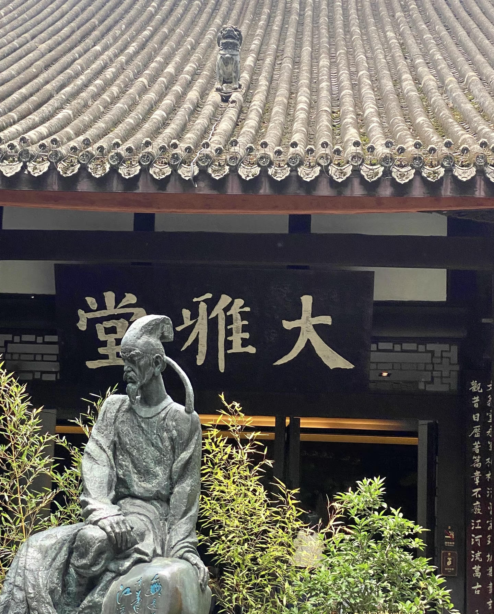
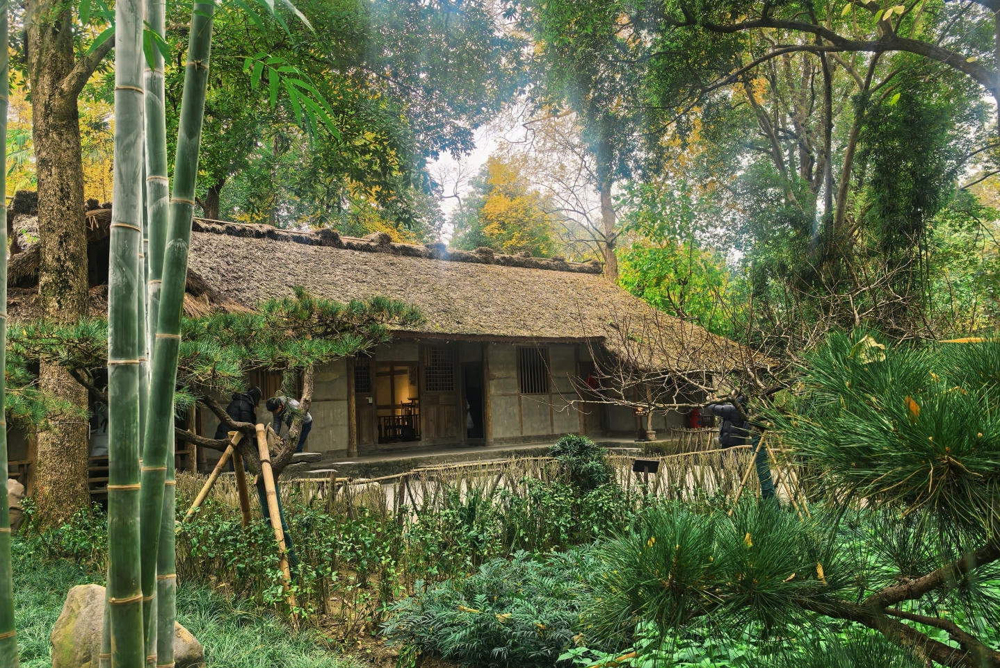

荣昌青少年宫的研学团，五十个孩子，半天时间。中午十二点半从酒店出发，一点整站在了杜甫草堂门口。秋冬的成都阳光很好，银杏正在黄——杜甫要是知道一千二百多年后有这么多娃娃专门来看他的房子，估计会把「漫卷诗书喜欲狂」改一改拿来用。

<!--more-->

## 行程

- 12:30 酒店出发
- 13:00 抵馆，正门集合分组
- 午后 中轴与西侧参观：诗史堂 → 景杜堂 → 大雅堂 → 茅屋故居
- 15:30 集合返程

## 经过

进馆先不进门，站在门口看东西——正门那副楹联：上联「异代不同时，问如此江山，龙蟠虎卧几诗客」，下联「先生亦流寓，有长留天地，月白风清一草堂」。郭沫若题的。我把上下联拆开讲：杜甫一千二百年前来成都，是流寓；写这副联的人当年在成都，也是流寓。今天你们从荣昌来成都研学，住着酒店——也算小小的流寓。今天的课题就这么定了：搞清楚一个「蓉漂」的大诗人，在成都怎么过日子。

五十人的队伍在正门前集合分组，黄马甲蓝马甲混在一起，像一群搬家的蜜蜂。分组这件事在研学团里不是仪式，是命——五十个人不分组，半小时后你就只能在工作人员广播里找孩子了。

「2号车」的牌子举起来，队伍拉进园子。牌子这东西看着土，但它是孩子在人群里认领「我们队伍」的锚点——举牌的人走得稳，队伍才走得稳。

途中我把「流寓」这个词翻译给孩子听：杜甫来成都的时候快五十岁了，朋友不多、积蓄更少，住的房子是亲友帮着张罗的——说白了，诗圣也是蓉漂，也得租房子。有孩子立刻接话：「那他交房租吗？」这个问题问得好——茅屋是朋友们凑材料帮忙盖的，严格说不算租，但「别人帮忙才能住上房」这个事实，孩子一听就懂了。

景杜堂一带人少些，堂前正挂着「情系草堂」的特展，孩子们在里面找到几件能对上课文的展品，兴奋得直挥手——课本里的名字和眼前的东西对上号，比任何讲解都管用。

大雅堂前的杜甫坐像是今天的第一个高潮。青铜像低着头、眉眼聚在一起，孩子们围上去，不用我开口先安静了半拍。我让他们看两处：一是那身衣服，宽松旧袍，不是官服；二是那个坐姿，不像端坐，像想事情想到一半停住了。忧国忧民四个字讲一百遍，不如这一眼。

压轴是茅屋故居。复建的茅草屋，竹篱、菜畦、一畦秋菜。我让孩子们站在屋前，把《茅屋为秋风所破歌》最后两句背出来——五十个人的声音在竹林里撞了一下：「安得广厦千万间，大庇天下寒士俱欢颜！」背完我补了一句：写这行字的人，自己住的正是这间被秋风吹破的茅屋。这一刻没有人打闹。半天的课，值的就是这一刻。

## 一点心得

1. 半天团的取舍比讲解重要：中轴一线加茅屋收尾，花径、碑亭都敢舍。五十个人一分钟都不能「走着看」——分车分组、讲解器人手一副，这两件事做在前面，后面全是顺的。
2. 「流寓 → 蓉漂」是今天最好用的讲解词。给孩子讲古人，先把身份翻译成他们熟悉的生活，再讲成就，顺序不能反。
3. 背诗环节要放在茅屋前现场做，提前把那两句印在任务卡上；孩子背出来的那一秒，比讲解员说十句都响。
4. 草堂的团队预约和讲解时段建议提前一周以上锁定；工作日正午前后是团队入场最顺的窗口，我们 13:00 进园、15:30 出园，人流舒服。
