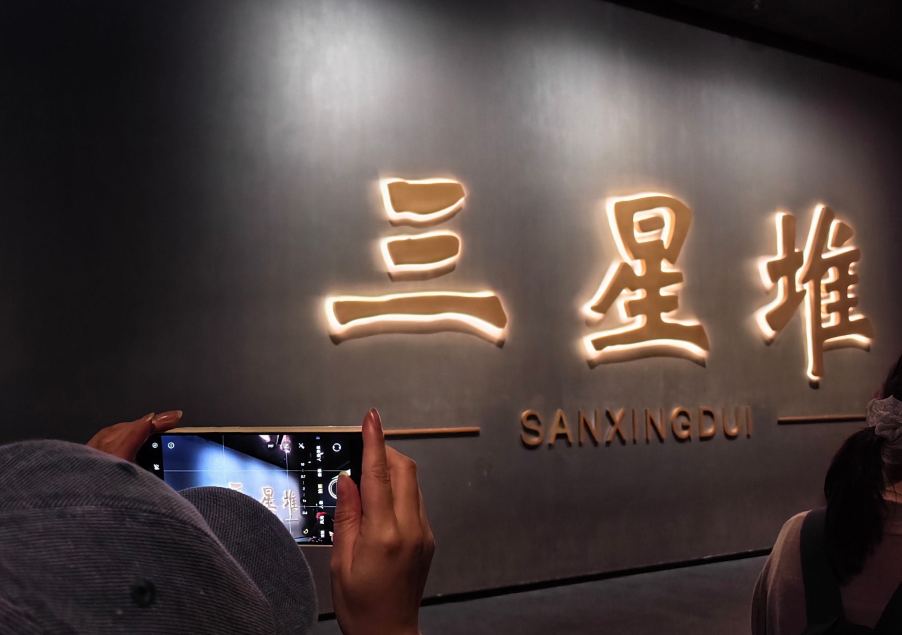
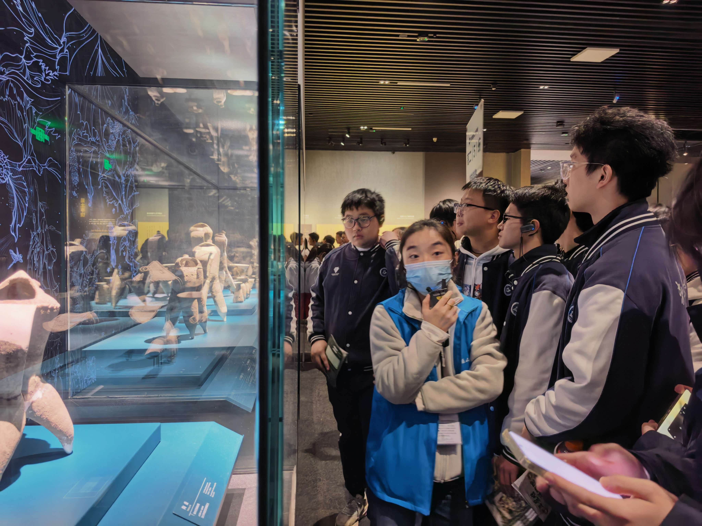
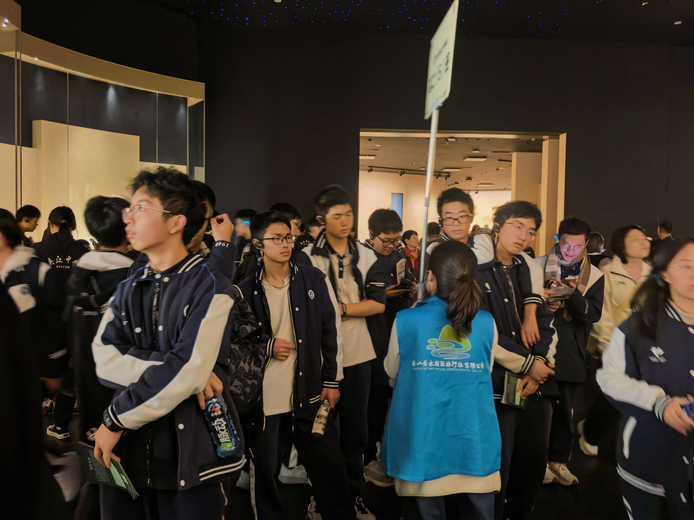
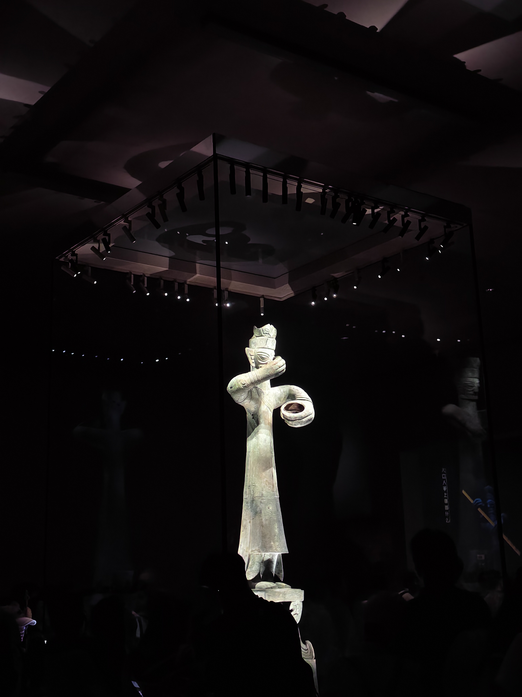
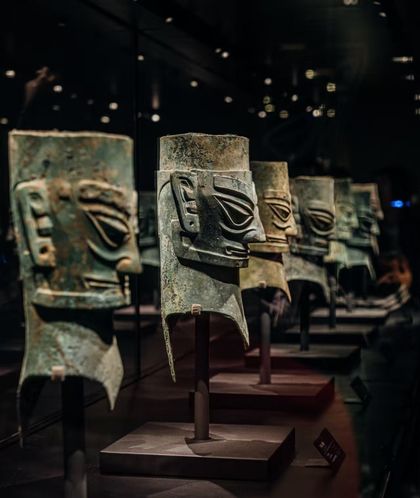
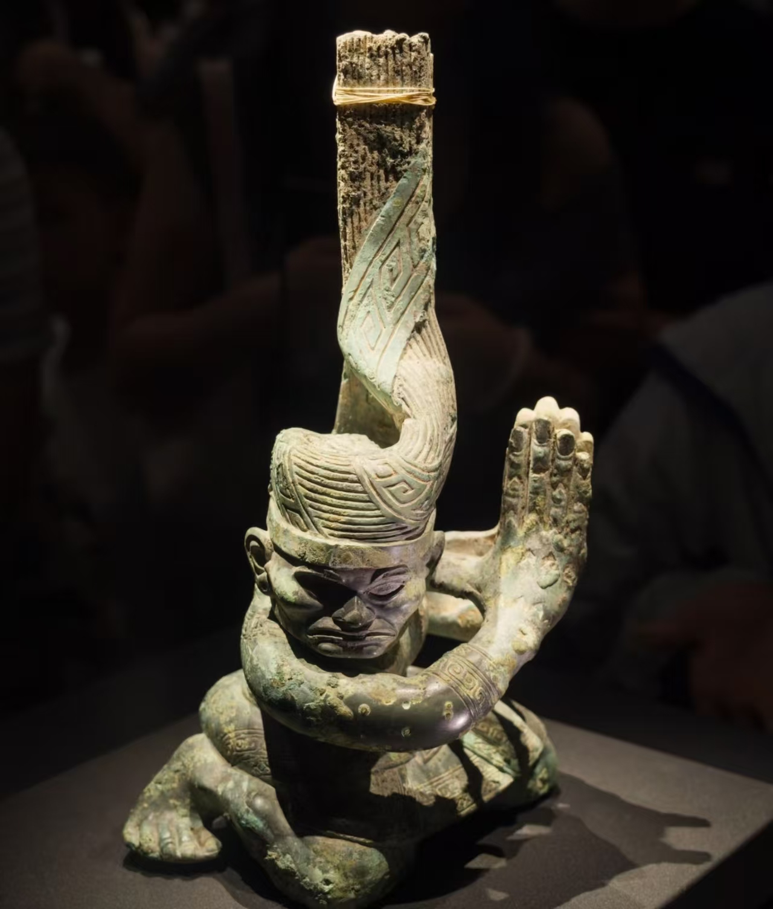
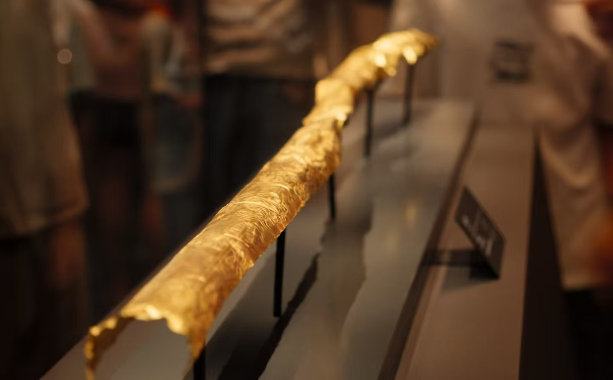
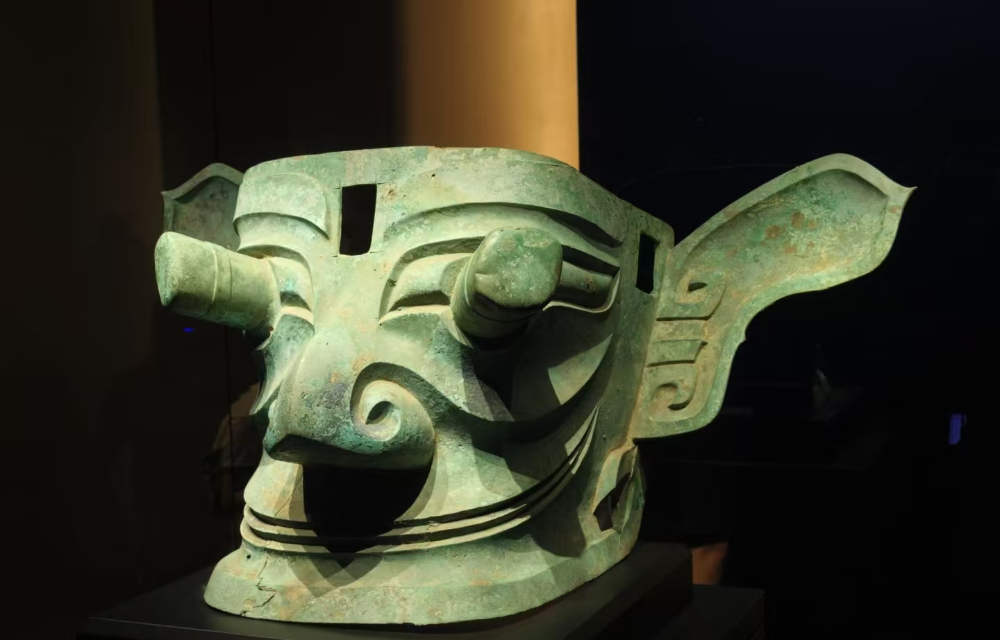

带研学团去三星堆，是我最喜欢的一类行程——不用看天气的脸色，文物永远在展厅里等你。十一月中旬这一趟，带的是夹江中学的孩子们：早上七点半从乐山夹江集合出发，大巴单程两个多小时，孩子们下车时还在打闹，进馆之后忽然就安静了。

<!--more-->

## 行程

- 07:30 夹江中学集合出发，车上发放研学手册与任务卡
- 10:00 前后抵馆，三星堆博物馆新馆：世纪逐梦 → 巍然王都 → 天地人神
- 午间 午餐，整理研学手册
- 下午 复看重点文物，集合返程，车上做成果分享

## 经过

进馆之前，先在标识墙前打卡。深色背景上「三星堆」三个字亮着，孩子们举着手机排成一排——先让他们拍够，正式看展时手机才收得下来。

工作日的展厅依然热闹。队伍排得长，孩子们隔着玻璃把展台围了两层，最前面的趴在展柜边上不肯挪——研学团的通病：不催不走，一走又冲太快。

我把孩子们聚拢在重点展柜前，人太多的时候不贪多，一件文物讲透就走。讲解这活儿，在三星堆不需要暖场——文物自己会说话，我只负责把话递到孩子耳朵里。

「巍然王都」厅的青铜大立人，是全程第一个高潮。我让他们只盯着一处看——那双手：环握成中空的圆，原本握着什么，至今没有答案。象牙、玉琮、权杖，三种说法都有学者主张。孩子们最爱这种没有标准答案的谜题，猜了一路。

一排青铜人头像前面，孩子们会自己发现亮点——有几个贴着金面罩。方脸、大耳、直鼻、阔嘴，五官像出自同一个模子，只有金面罩把身份分出了高下。不用我讲，他们已经小声在讨论「贴金的更贵」。

顶尊跪坐人像是新近出土的明星文物：头顶着尊，上身端正，跪得一丝不苟。我给它的讲解词只有一句：三千多年前的礼仪课代表。孩子们笑完，照片拍了不少。

金杖展柜前人最挤。一米四二的杖身，金皮卷制，木芯早已朽尽，只剩金皮上的纹饰还在讲故事：两背相向的鸟、两背相向的鱼，一支长羽箭贯穿其间，旁边还有戴冠的人头像。古蜀历史上有位蜀王叫鱼凫——凫，就是鸟。鱼与鸟同在一杖，有人说，这就是王的名片。

压轴留给纵目面具。宽一米三八，双眼呈柱状向外凸出十多厘米，双耳向两侧张开。孩子们一看就喊「千里眼、顺风耳」。《华阳国志》里说，第一代蜀王蚕丛「其目纵」。我最后补了一句：也许古蜀人只是把「看得更远、听得更清」的愿望，铸进了青铜里。这一次，没有人接话——他们真的在看。

## 一点心得

1. 三星堆新馆人气常年不低，团队票与讲解时段要提前一周以上对接；开馆后的第一个小时观众最少，值得先把镇馆之宝走一遍，再回头细看。
2. 给孩子讲文物，一件只留一个记忆点：大立人讲「手」，金杖讲「鱼和鸟」，纵目面具讲「眼睛」。讲多了，回程大巴上他们一个也复述不出来。
3. 任务卡比单向讲解有效十倍。这趟的任务是：找一件「最像外星人」的文物，并写下三个「它不是外星人」的理由——回程吵了一路，比我的讲解热闹多了。
4. 车程别浪费：去程讲任务规则，回程做成果分享，一天的研学才算闭环。
